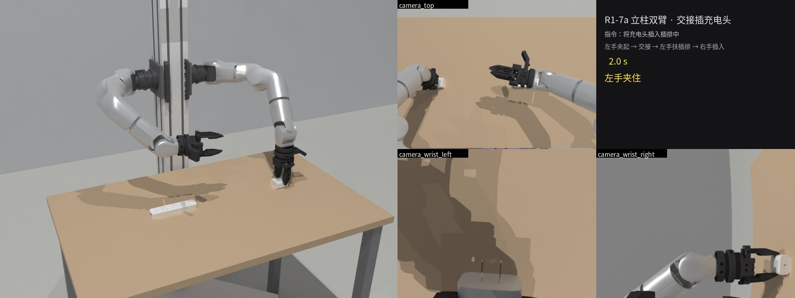
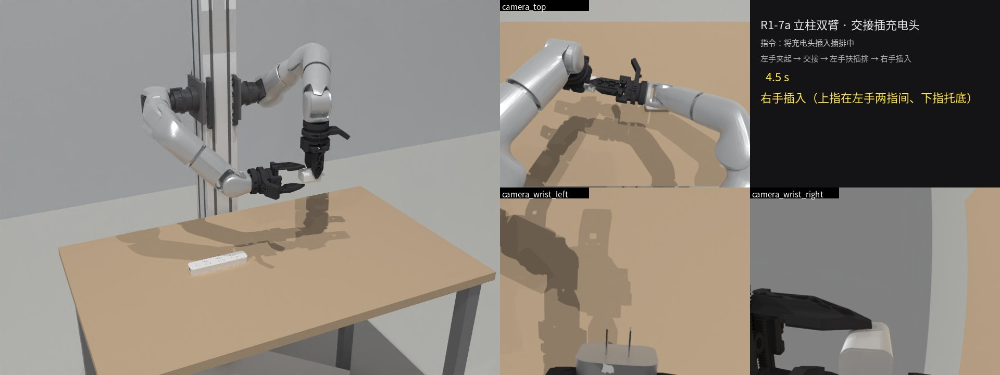
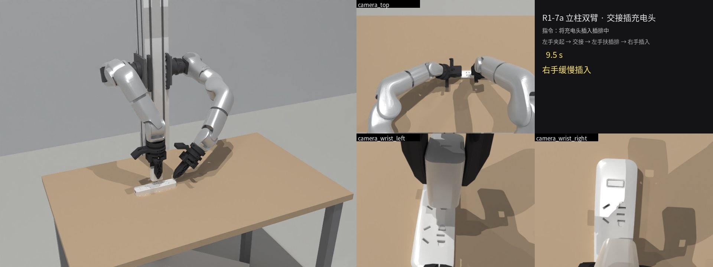
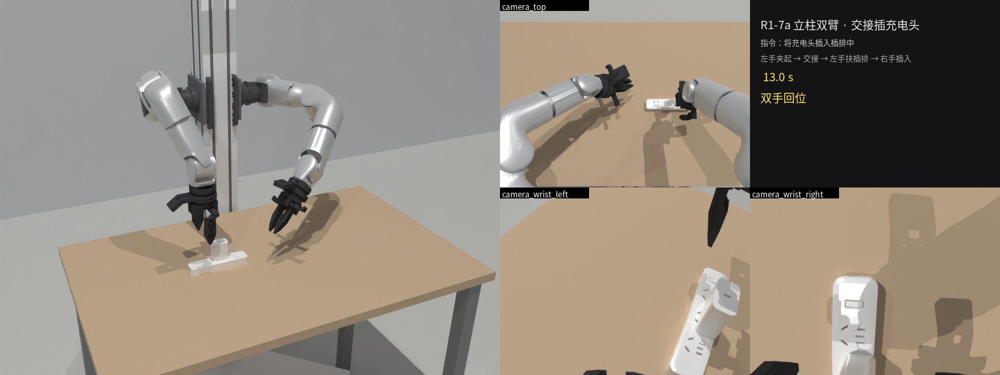
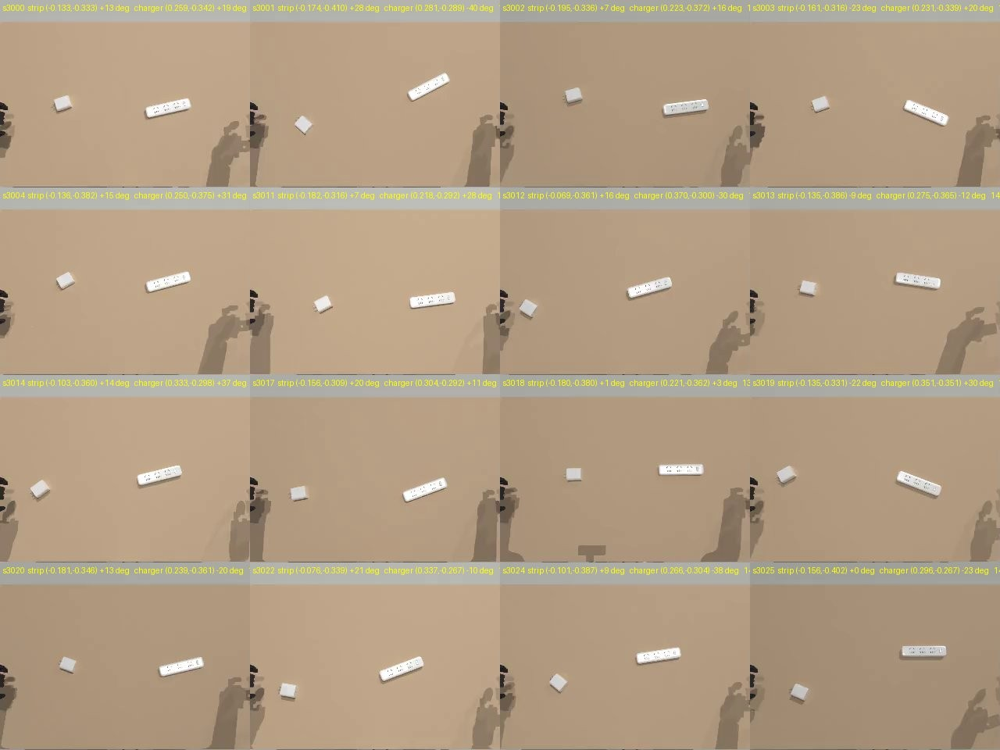

# RL Token 复现：宇树 R1-7a 与 Cobot Magic 插充电头

在"把充电头插进排插"这个毫米级任务上复现 RL token（RLT，Xu et al. 2026，Physical Intelligence）的阶段性代码和记录。RL token 分两个阶段：阶段一在 VLA 微调的同时训练一个小编码器，把 VLA 内部表征压成一个向量；阶段二在这个向量上做在线强化学习。

我们在两台机器人上各做一部分：**松灵 Cobot Magic** 用自采的 100 条真机示教训练 VLA 和 RL token 阶段一；**宇树 R1-7a** 先在仿真里搭双臂场景、生成示教、训练基线。

**阶段二（在线强化学习）还没有开始，目前不能说复现完成。**

## 宇树 R1-7a 仿真示教

两条 R1-7a 装在立柱上，配 Dex1-1 夹爪。SAPIEN 光线追踪渲染，物理仿真 1200 Hz，插入是真实接触。每张图左边是总览，右边是模型看到的头部、左腕、右腕三路相机。

**1. 左手竖直夹起充电头，右手同时到交接位**

**2. 右手从尾部接过：上指伸进左手两指之间，下指托底**

**3. 左手扶住排插，右手竖直缓慢插入；左腕相机正对插孔**

**4. 插到底，双手松开回位**

**随机摆位**：16 条示教的头部相机初始画面。充电头和排插的位置、朝向都随机；先只跑物理筛出按规范动作做得成的摆位，再渲染。

完整视频（每条约 14 秒）：[标准摆位](assets/r1_dual_nominal.mp4)、[随机摆位](assets/r1_dual_random.mp4)。数据集共 128 条、54244 帧，全部插到底，两臂全程无碰撞。

## 现在做到哪了

截至 2026-11-20。

| 内容 | 机器人 | 状态 |
|---|---|---|
| RL token 阶段一模块，与 VLA 微调并行训练 | Cobot Magic 真机数据 | 已完成 |
| LingBot-VLA v2 全量微调 | Cobot Magic 真机数据 | 已完成；真机交接时双臂相撞 |
| "RL token 里有没有毫米级几何"诊断 | Cobot Magic 真机数据 | 已完成 |
| 立柱双臂模型与规范动作示教（128 条） | 宇树 R1-7a 仿真 | 已完成 |
| SmolVLA、π0.5、LingBot-VLA 三个基线训练 | 宇树 R1-7a 仿真 | 进行中，尚无闭环评测 |
| LingBot-VLA 训练提速 | — | 两项已用上，老师输出缓存在做 |
| RL token 阶段二 | 两者 | 未开始 |
| 宇树 R1-7a 真机 | 宇树 R1-7a | 未开始 |

## 主要结果

**RL token 阶段一（Cobot Magic 真机数据）**
- 模块读 VLA 最后一层的前缀隐状态，压成 2048 维的 RL token，再只靠它重建前缀；约 2.9 亿参数。
- 不干扰主线：开和关模块各跑一遍，前 10 步主线的损失和梯度范数逐位相同。
- VLA 本身：4000 步开环手臂误差 0.83°；真机能夹起插头，但交接时双臂相撞，所以阶段二还没有在真机上启动。

**表征诊断**（插入前最后 30 毫米，从各种表征里读"插头离插孔还差多少"）

| 输入 | 中位误差（毫米） |
|---|---|
| RL token | 8.2 |
| 右腕相机的 VLA token | 8.3 |
| 只用关节角 | 10.9 |
| 头部相机的 VLA token | 约 11.8 |
| 直接假设"已经到位" | 16.8 |

- RL token 的精度和它的输入一样，没有丢几何信息；腕部相机比头部好 1.5 到 3 毫米。
- 约 100 条真机示教加事后标签分辨不了毫米级，这是转去做带真值的仿真的原因。

**LingBot-VLA 训练提速**（4 卡，全局批量 256）

| 配置 | 秒/步 |
|---|---|
| 基线 | 8.22 |
| 梯度累积的微批之间不重新切分参数 | 7.94 |
| 再加：Muon 每个矩阵只在一张卡上做正交化 | 6.22 |

π0.5（8 张不支持直连的 RTX 4090）和 SmolVLA（2 张 A40）没有找到不改训练配方的提速办法，原因见 `speedups/`。

## 目录

| 目录 | 内容 |
|---|---|
| `rl_token/` | RL token 阶段一模块、接入 LingBot-VLA 训练循环的补丁、随机数隔离的单元测试 |
| `representation_probe/` | 特征提取和探针脚本（表征诊断） |
| `sim_r1/` | 立柱双臂 URDF 生成、逆运动学、两臂碰撞检查、示教生成、布局搜索、转 LeRobot 格式 |
| `training/` | 三个模型的训练配置和数据接入代码 |
| `speedups/` | LingBot-VLA 的分步计时、两项提速补丁、老师输出缓存 |
| `tools/` | 多卡一致性自检、训练 NaN 看门脚本 |
| `assets/` | 上面的截图和两条样片视频 |

每个目录里有单独的说明。

## 仓库里没有的东西

这些需要自己准备，脚本里对应的路径都是占位符（`/path/to/...`）：

- **宇树 R1-7a 和 Dex1-1 的 URDF 与网格**：从宇树官方获取。
- **排插和充电头模型**：来自 RoboDojo 基准 plug_in_charger 任务的素材。
- **模型代码和预训练权重**：LingBot-VLA v2、openpi（π0.5）、LeRobot（SmolVLA）用各自的官方仓库，这里只有针对它们的补丁和配置。
- **真机数据和我们训练出的权重**。

## 说明

- 脚本是研究过程中的工作代码，注释里保留了当时的日期和修改原因，没有整理成可安装的包。
- 多数脚本原本在特定机器上运行，换环境需要改路径和 Python 环境。
